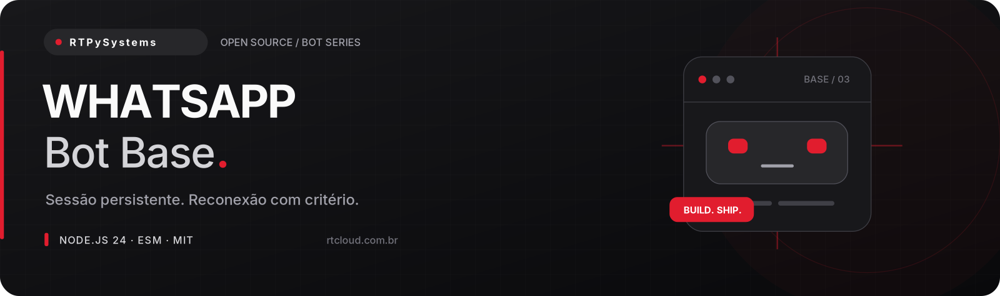

# WhatsApp Bot Base

**Uma base enxuta para começar direito — e organizada para continuar crescendo.**

Projeto aberto de [RTPySystems](https://github.com/RTPySystems), desenvolvedor e criador da
[RTCloud](https://rtcloud.com.br). Sem arquivos gigantes ou configuração escondida: cada parte
tem seu lugar, do primeiro comando até o encerramento do processo.

[Começar](#começar) · [Configuração](#configuração) · [Estrutura](#estrutura) · [Deploy na RTCloud](#deploy-na-rtcloud) · [Operação](docs/OPERACAO.md)

## O que vem na base

| Recurso                     | Como funciona                                                                                                     |
| --------------------------- | ----------------------------------------------------------------------------------------------------------------- |
| **Autenticação flexível**   | QR no terminal ou código de pareamento, com credenciais persistidas localmente e diretório privado.               |
| **Reconexão responsável**   | Backoff exponencial com jitter, teto de tentativas e parada em logout, sessão inválida ou conexão substituída.    |
| **Proteção desde o começo** | Anti-spam por remetente, deduplicação, fila limitada e grupos desativados por padrão. Sem disparos em massa.      |
| **Qualidade e segurança**   | ESLint, Prettier, testes com `node:test`, CI configurada, configuração validada e logs sem conteúdo de conversas. |


## Começar

**Requisitos:** Node.js **24.17+ na linha 24 LTS**, npm e uma conta na plataforma do bot.
As dependências estão fixadas e o lockfile acompanha o projeto. Baixe ou clone este repositório,
entre na pasta e execute:

```bash
npm ci
cp .env.example .env
```

No Windows sem Bash, copie `.env.example` para `.env` pelo explorador. Preencha as variáveis
antes de iniciar; **nunca versione o arquivo `.env`**.

1. Leia o aviso sobre a API não oficial abaixo. Use um número dedicado para testes, nunca uma conta crítica.
2. Configure `WHATSAPP_ENABLED=true` no `.env`. O padrão é não conectar.
3. Para **QR**, mantenha `AUTH_MODE=qr`. Rode `npm start` e leia o QR em **WhatsApp → Aparelhos conectados → Conectar aparelho**.
4. Para **pareamento**, use `AUTH_MODE=pairing` e `WHATSAPP_PHONE` com país, DDD e número, sem pontuação. Rode `npm start` e escolha a opção de conectar usando número de telefone no aplicativo.
5. Depois da conexão, envie `!ping` de **outra conta**. Mensagens enviadas pela própria conta conectada são ignoradas.

O código de pareamento só é solicitado depois do evento QR, quando o socket está pronto. QR e código são credenciais temporárias: aparecem no console apenas para autenticar. Não publique prints nem compartilhe logs dessa etapa.

> Sem credenciais ou aceite de conexão, `npm start` encerra com uma mensagem em português e código 1.
> Os testes não precisam de tokens nem de uma conexão com a plataforma.

## Comandos

| Comando  | Função                           | Acesso               |
| -------- | -------------------------------- | -------------------- |
| `!ping`  | Confirma que o bot está online.  | Conversas permitidas |
| `!help`  | Mostra a lista de comandos.      | Conversas permitidas |
| `!about` | Apresenta o projeto e a RTCloud. | Conversas permitidas |

## Configuração

| Variável                 | Obrigatória     | Padrão           | Uso                                            |
| ------------------------ | --------------- | ---------------- | ---------------------------------------------- |
| `WHATSAPP_ENABLED`       | Sim             | `false`          | Defina `true` somente depois de ler os riscos. |
| `AUTH_MODE`              | Não             | `qr`             | `qr` ou `pairing`.                             |
| `WHATSAPP_PHONE`         | No modo pairing | —                | País + DDD + número, apenas dígitos, sem `+`.  |
| `SESSION_DIR`            | Não             | `./data/session` | Pasta privada em disco persistente.            |
| `COMMAND_PREFIX`         | Não             | `!`              | De 1 a 3 caracteres, sem espaços.              |
| `ALLOW_GROUPS`           | Não             | `false`          | Aceita comandos em grupos somente se `true`.   |
| `RATE_LIMIT_MAX`         | Não             | `4`              | Comandos por remetente por janela (1–100).     |
| `RATE_LIMIT_WINDOW_MS`   | Não             | `10000`          | Janela em milissegundos (1000–3600000).        |
| `RECONNECT_MAX_ATTEMPTS` | Não             | `8`              | Máximo de reconexões consecutivas (1–20).      |
| `LOG_LEVEL`              | Não             | `info`           | Nível de log da aplicação.                     |

O `.env` é carregado pelos scripts `npm start` e `npm run dev`. Na hospedagem, prefira variáveis
no painel. Valores inválidos interrompem a inicialização; nenhuma credencial é incluída na mensagem.

## Estrutura

```text
src/
├── auth/session.js          # adaptador de sessão local
├── commands/index.js        # catálogo de comandos
├── connection/              # lifecycle e política de reconexão
├── handlers/router.js       # parsing, deduplicação e anti-spam
├── lib/                     # logs, limites e shutdown
├── config.js
└── index.js
scripts/                     # smoke test sem ativar conexão
test/                        # socket simulado e persistência local
data/session/                # criada em runtime; nunca versionada
```

### Criar seu primeiro comando

Inclua uma entrada no `Map` de `src/commands/index.js`:

```js
['ola', {
  description: 'Enviar uma saudação',
  execute: async ({ reply }) => reply('Olá!'),
}],
```

O handler recebe `args`, `message`, `socket`, `reply` e `commands`. Evite efeitos colaterais sem confirmação, valide os argumentos e não envie dados pessoais ao console. O roteador aceita texto simples e texto estendido; mídias e comandos em legendas não são processados nesta base.

## Deploy na RTCloud

A [RTCloud](https://rtcloud.com.br) hospeda bots, sites e APIs. O projeto não depende de SDK
proprietário: funciona também em qualquer ambiente compatível com Node.js 24.

1. Valide localmente: `npm run lint && npm test && npm run test:startup`.
2. Envie o código por **GitHub ou ZIP** no fluxo de deploy de bot. Exclua `node_modules`, `.git`, `.env` e sessões do pacote.
3. Selecione **Node.js 24**, instale com `npm ci --omit=dev` e use `npm start` como comando de execução (entrada: `src/index.js`).
4. Cadastre as variáveis da tabela no painel. Nunca coloque tokens no README ou no arquivo de entrada.
5. Abra o console, confira a mensagem de conexão e teste um comando. Esta base é um **worker/bot**, não um site HTTP; não expõe porta pública.

Confira as opções atuais na [documentação da RTCloud](https://docs.rtcloud.com.br).

**WhatsApp exige disco persistente e uma única instância.** Configure `SESSION_DIR` no volume antes de autenticar; não substitua a pasta a cada deploy. Restrinja o acesso ao console durante QR/pareamento. Leia os limites do adaptador abaixo antes de colocar em produção.

### Usar Docker

```bash
docker build -t whatsapp-bot-base .
docker run --rm --init --env-file .env \
  --mount source=rtbot-whatsapp-data,target=/app/data \
  whatsapp-bot-base
```

A imagem usa usuário sem privilégios, instala apenas dependências de produção e trata `SIGTERM`.
Não copie segredos para dentro da imagem. O Dockerfile é uma alternativa ao runtime Node da hospedagem.

## Desenvolvimento e verificação

```bash
npm run dev           # reinicia ao salvar
npm run lint          # ESLint
npm run format:check  # Prettier sem alterar arquivos
npm test              # testes unitários e de integração simulada
npm run test:startup  # valida saída segura sem credenciais
```

Para formatar, use `npm run format`. O workflow em `.github/workflows/ci.yml` executa instalação,
lint, formatação, testes e smoke test em cada push ou pull request. A CI está **configurada**;
a execução na plataforma depende da publicação do repositório.

## Limites e cuidados

**Baileys é uma API não oficial.** Este projeto não é afiliado ao WhatsApp ou à Meta. Mudanças do serviço podem quebrar o bot ou restringir a conta. Anti-spam não elimina o risco de bloqueio. Para atendimento empresarial crítico, avalie a [WhatsApp Business Platform oficial](https://developers.facebook.com/docs/whatsapp/).

A versão fixada é **7.0.0-rc14**, um release candidate: atualizações exigem revisão das notas de versão e testes. O adaptador `useMultiFileAuthState` é adequado a desenvolvimento e uma instância pequena; a própria documentação do Baileys **não o recomenda para produção**. Antes de operar um serviço crítico, implemente um `AuthenticationState` com armazenamento transacional, controle de acesso e backup criptografado. O adaptador está isolado em `src/auth/session.js` para facilitar a troca.

A deduplicação e os limites são locais ao processo e se perdem no reinício. Uma nova sessão conectada com outra conta pode exigir reautenticação manual. Grupos são opt-in e o identificador do remetente pode ser LID, não telefone. A base não resolve aliases PN/LID; eles podem ter contadores distintos. Não há leitura de histórico, disparos em massa, scraping ou promessa de entrega garantida.

Logs são JSON para o console, sem gravar mensagens de usuários. A aplicação omite URL, mensagem
e stack dos erros de bibliotecas para evitar vazamento de credenciais; o tipo do erro permanece
para diagnóstico. Durante a operação, use os códigos e o contexto seguro do evento. `SIGINT` e
`SIGTERM` iniciam um encerramento com prazo de 10 segundos. Falhas fatais encerram com código 1.

## Contribuir e licença

Melhorias são bem-vindas. Veja [CONTRIBUTING.md](CONTRIBUTING.md) antes de abrir um PR.
Licença [MIT](LICENSE) — você pode estudar, adaptar e usar comercialmente, mantendo o aviso da licença.

### Referências técnicas

[Conexão e pareamento](https://baileys.wiki/authentication/pairing-code) · [Persistência e limites do auth state](https://baileys.wiki/authentication/session-management) · [Baileys](https://github.com/WhiskeySockets/Baileys)

---

**RTPySystems** · Projetos com propósito, código com estrutura.  
[Perfil](https://github.com/RTPySystems) · [RTCloud](https://rtcloud.com.br) · [Documentação](https://docs.rtcloud.com.br)
